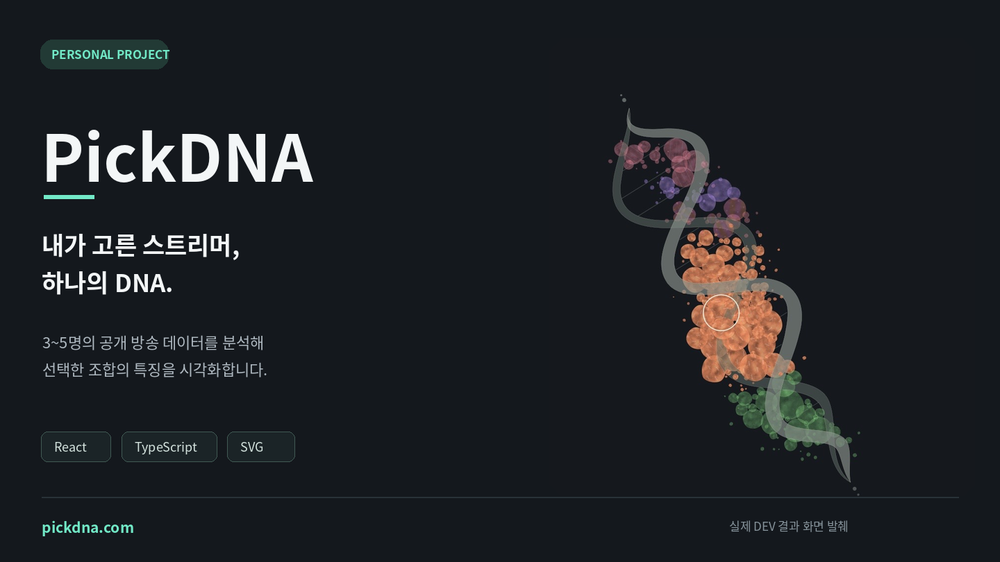

# Jayden

### Web Publisher · Frontend UI Developer

웹 퍼블리싱을 기반으로 React와 TypeScript를 활용한 UI 개발을 하고 있습니다.

HTML, CSS, JavaScript를 활용한 화면 구현과 반응형 웹, 웹 접근성에 관심을 가지고 작업하고 있습니다.

---

### About Me

- 웹 퍼블리싱 및 프론트엔드 UI 개발
- HTML, CSS, JavaScript 기반 마크업 및 인터랙션 구현
- React, TypeScript를 활용한 UI 컴포넌트 개발
- 반응형 웹 및 웹 접근성을 고려한 화면 구현
- AI 개발 도구를 활용한 개인 웹 프로젝트 개발 및 운영

### Tech Stack

**Frontend**

**Tools & Workflow**

`Codex` · `Responsive Web` · `Web Accessibility`

---

### Projects

#### [PickDNA](https://pickdna.com)

치지직 스트리머 3~5명의 공개 방송 데이터를 분석하고, 선택한 조합의 특징을 DNA 형태로 시각화하는 개인 웹 프로젝트입니다.

**주요 기능**

- 스트리머 검색 및 3~5명 조합 분석
- 공개 방송 기록을 활용한 콘텐츠별 특징 분석
- SVG 기반 인터랙티브 DNA 시각화
- 스트리머별 콘텐츠 기여도 및 분석 근거 제공
- 분석 결과 PNG 이미지 저장 및 공유
- PC·모바일 반응형 UI

**기술 및 개발 환경**

`React` · `TypeScript` · `Vite` · `Cloudflare Workers`

**[Visit Website](https://pickdna.com)**

---

### Development

AI 개발 도구를 활용해 개인 프로젝트를 개발하고 운영하고 있습니다.

기능 구현뿐 아니라 UI 구성, 사용자 흐름, 데이터 표현 방식과 실제 서비스 운영 과정을 함께 다루고 있습니다.
